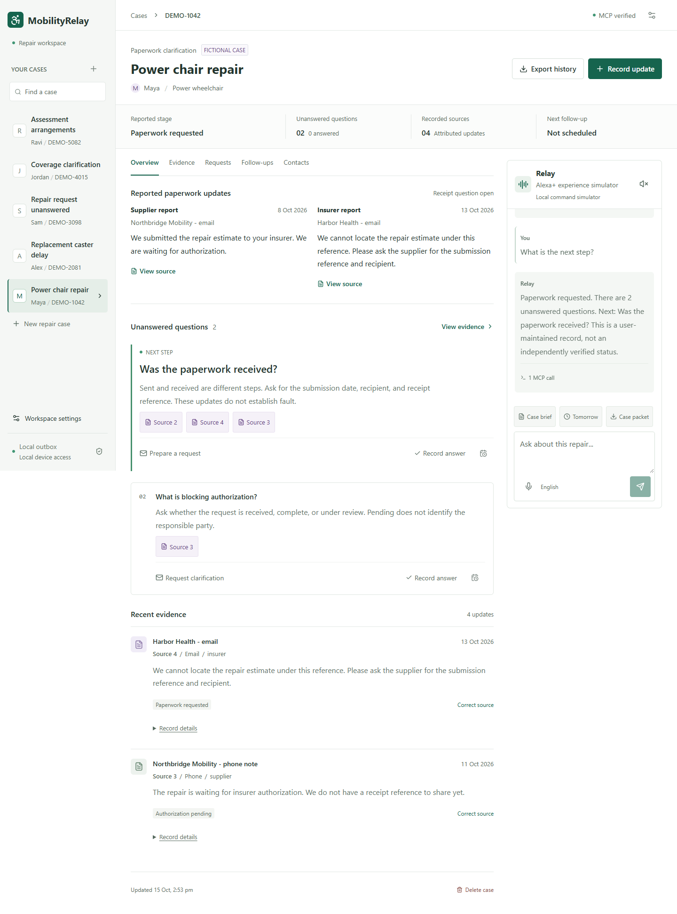

# MobilityRelay

**A clearer next step when a wheelchair repair gets stuck.**

MobilityRelay helps wheelchair users and caregivers bring scattered repair
updates into one dated record, identify unanswered questions, and prepare a
source-backed follow-up they can review and approve.

Built for the **Alexa+ track** of the Amazon Developer Hackathon: an independent
voice/text **Alexa+ experience simulator**, backed by a real self-hosted MCP
server over Streamable HTTP. Native Alexa+ integration is not claimed.

[Quick Start](#quick-start) | [How It Works](#how-it-works) |
[Verification](#verification) | [Project Guide](docs/project-guide.md)



*Actual application screenshot using fictional records and the local command
simulator, not native Alexa+ or a live supplier integration.*

## The Problem

> The supplier says, "We sent the estimate."
> The insurer says, "We cannot locate it."
> The user is left to work out what happened and whom to ask next.

MobilityRelay preserves both reports without assigning blame. It turns the gap
into an actionable question: **Was the estimate received, and what reference
can confirm it?** The next request cites the user's recorded sources rather
than inventing an answer.

A 2025 study of 301 wheelchair users with spinal cord injury found vendor
noncompletion after contact was the most common reported reason for incomplete
repairs. This supports the coordination problem, not the effectiveness of our
app or a population estimate for all wheelchair users.
[Read the study](https://pubmed.ncbi.nlm.nih.gov/39427781/).

## How It Works

**Record -> clarify -> prepare -> approve -> follow up -> export**

- **Keep the history:** record attributed, dated updates; corrections preserve the original source.
- **Find the next question:** show missing information and the reports behind it, not a verdict about who is wrong.
- **Review before acting:** prepare a source-backed draft and approve the exact recipient and message. Default mode captures it locally, not by email.
- **Hand over the case:** save persistent follow-ups and export an HTML/JSON history with optional known-identity redaction.

Speech input and spoken replies are optional; text and forms remain available.
Follow-ups are local due items, not autonomous messages or background reminders.

## Real MCP, Reviewed Actions

```text
React workspace -> Express host -> MCP SDK client over HTTP
                -> /mcp -> validated repair tools -> SQLite
```

The host initializes the server, discovers its tools and calls them over HTTP;
successful calls appear in the conversation trace. Protocol `2025-11-25` is
covered by wire tests.

| MCP tool | Purpose |
| --- | --- |
| `record_repair_event` | Save a user-reviewed, attributed update. |
| `get_repair_brief` | Read the history, unanswered questions and next steps. |
| `prepare_repair_request` | Prepare a draft without sending it. |
| `send_approved_request` | Attempt only the exact message with valid user approval. |
| `manage_repair_followup` | Maintain a persistent follow-up item. |
| `export_repair_packet` | Export a source-attributed HTML or JSON case history. |

AI cannot record evidence or send messages through the simulator. Those actions
require trusted user review. The stack is **TypeScript, React, Vite, Express,
SQLite, the official MCP SDK and Zod**, with optional Ollama, Bedrock and SMTP.

## Quick Start

Requires **Node.js 24+ and npm**. No AWS account or API key is needed for the
default local mode, which is a limited command interpreter, not an LLM.

```sh
npm ci
npm run dev
```

Open **http://127.0.0.1:4317**. Five labelled fictional cases are seeded on an
empty database. Local records persist in ignored `.data/mobilityrelay.sqlite`.

### Optional Local AI

Install [Ollama](https://ollama.com/) separately, then:

```sh
ollama pull qwen2.5:1.5b
npm run dev:ollama
```

Open **http://127.0.0.1:4318**. This uses a separate fictional database and local
message capture. CPU inference can take tens of seconds; replies still need
review. Model weights are downloaded separately.

See [configuration and hosting](docs/project-guide.md#2-run-the-project) for
environment variables, Windows installation guidance and optional integrations.

## Verification

Latest backend/setup recheck: **October 18, 2026**. Earlier integration checks
below retain their documented scope in the project guide.

| Check | Result |
| --- | --- |
| Backend tests | 105 passed, including ten SMTP setup/verification checks |
| Desktop/mobile-emulation browser tests | Earlier full run: 42 passed; October 18 targeted workflow checks: 4 passed |
| TypeScript and production build | Passed |
| Automated accessibility | 21 scans; no detected violations in the tested views |
| Actual local AI + MCP | Seven-scenario Ollama-mode API workflow and desktop/mobile UI check passed |
| Production Docker image | Earlier image passed isolated checks; the latest SMTP setup has not been container-retested |
| Clean source installation | Earlier fresh-cache installation passed on this Windows host; dependencies are unchanged. Latest GitHub checkout still needs verification. |
| Dependency audit | Zero known vulnerabilities at the time of testing |

```sh
npm run check
npm run test:browser
```

Browser tests require installed Microsoft Edge. Results use isolated fictional
records; automated speech checks are simulated. They do not establish full
accessibility conformance, general model accuracy or real-world benefit.
See [QA evidence and limits](docs/project-guide.md#4-testing-and-latest-results).
For Gmail, use the [connection-only check and controlled inbox test](docs/project-guide.md#gmail-connection-and-inbox-test).
The complete Docker Compose/Ollama stack and public HTTPS deployment are not
verified; see [Docker setup](docs/project-guide.md#docker-and-local-ai).

The workflow recheck fixed stale refreshes hiding new replies/follow-ups,
made the supported tomorrow reminder deterministic across agent modes, and
replaced generated case-status claims with structured MCP-backed summaries.
English recognition/output settings are regression-tested; physical audio is
still unverified. Some CPU inference requests still take roughly 30 seconds.

The October 15 performance fix removes repeated MCP negotiation and redundant
AI completion calls. In the measured workload, median case reads fell from
421 ms to 81 ms; a separate real-AI browser draft review took 13 seconds versus
the earlier 71-second observation. These are local measurements, not a speed
guarantee. See the guide for the before/after setup and limitations.

## Important Boundaries

- **Capture is not delivery.** SMTP and Bedrock adapters are implemented but not live-verified. Native Alexa+, physical speech hardware and public hosting remain unverified.
- **Coordination is not repair.** The app cannot supply parts, approve insurance, force a response, diagnose faults or guarantee a faster repair.
- **Use fictional data.** This is a shared-workspace prototype with plaintext SQLite storage, not a compliant clinical system. Browser speech may use a vendor service. Export redaction is limited and needs review.

## Documentation and License

The **[Project Guide](docs/project-guide.md)** is the single detailed document
for architecture, safety, testing, remaining work, the demo script and product
feedback. User benefit and repair-time savings have not been validated.

Code is available under the [MIT License](LICENSE). Optional model weights have
their own license.
