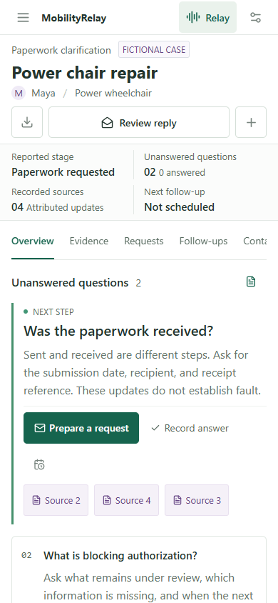
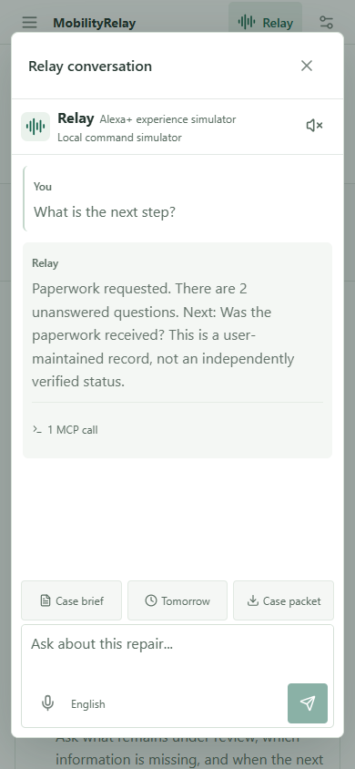
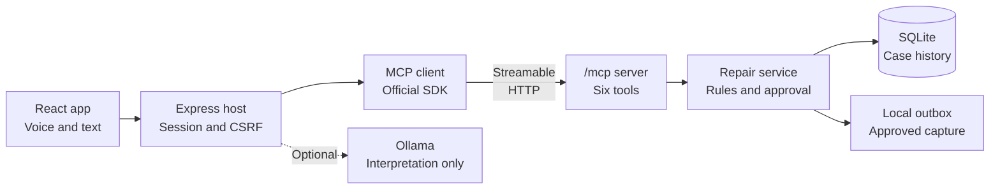

<p>
  
</p>

# MobilityRelay


**Turn conflicting wheelchair repair updates into clear next steps.**

A voice-and-text repair coordination workspace for wheelchair users and
caregivers, powered by a real MCP server. Organize dated reports, prepare
reviewed follow-ups and share the case history without assigning blame.

Built for the **Alexa+ track** of the Amazon Developer Hackathon as an independent
**Alexa+ experience simulator**, using **Streamable HTTP**.

[Demo Video](#demo-video) |
[Quick Start](#quick-start) | [Architecture](#mcp-integration) |
[Verified Results](#verification) |
[Project Guide](docs/project-guide.md)

## Demo Video

**YouTube walkthrough:** Link will be added after upload.

The locally generated **2:57 English demo** follows Maya's fictional repair
case, with computer-generated narration and captions. YouTube upload is pending.

| Approximate time | What the walkthrough demonstrates |
| --- | --- |
| `0:00-0:10` | The repair-coordination problem and project introduction. |
| `0:10-0:34` | Conflicting reports, dated sources, actual Ollama interpretation and MCP calls. |
| `0:34-0:49` | A contextual, source-backed request prepared for review. |
| `0:49-1:30` | A reviewed reply confirms receipt while authorization remains unanswered. |
| `1:30-2:09` | Stale approval is blocked; a fresh request receives explicit approval into local capture. |
| `2:09-2:23` | A saved local due item survives reload. |
| `2:23-2:43` | Redacted history export with sources and the remaining question. |
| `2:43-2:57` | Six real tools, implementation summary and honest scope limits. |

[Full recording script](docs/project-guide.md#6-demo-script-target-245).

## Product Preview

### Desktop


### Mobile

Repair workspace and Relay conversation:

<p>
  
  
</p>

Actual application captures with fictional records and the local command
simulator. Mobile screenshots use a 390x844 browser-emulated viewport.

## The Problem

> The supplier says, "We sent the estimate."
>
> The insurer says, "We cannot locate it."
>
> The user is left to work out what happened and whom to ask next.

MobilityRelay keeps both reports and turns the gap into a practical question:
**Was the estimate received, and what reference can confirm it?** A follow-up
can cite the recorded sources instead of inventing an answer or assigning blame.

A 2025 study of 301 wheelchair users with spinal cord injury found vendor
noncompletion after contact was the most common reported reason for incomplete
repairs. This supports the coordination problem, not the effectiveness of our
app or a population estimate for all wheelchair users.
[Read the study](https://pubmed.ncbi.nlm.nih.gov/39427781/).

## What Changes

Maya's **fictional walkthrough** illustrates the workflow, not a measured
real-world outcome:

| Step | Case state |
| --- | --- |
| Before | The supplier reports sending the estimate; the insurer reports not locating it. The receipt question is unanswered. |
| After review | The user records a receipt confirmation with its source, prepares a fresh authorization follow-up and can export the dated history. |
| Still unresolved | Authorization remains pending. Confirmed receipt is not insurance approval or a completed repair. |

## How It Works

1. **Record:** add dated updates attributed to their sources; corrections preserve the original.
2. **Clarify:** see the next unanswered question and the evidence behind it.
3. **Prepare:** draft a source-backed request without sending it.
4. **Approve:** review the exact recipient and message; the default outbox captures it locally.
5. **Review replies:** inspect the proposed changes and explicitly confirm answers. Received does not mean approved; changed evidence invalidates outdated drafts.
6. **Follow up and export:** save local due items and download a source-linked HTML/JSON history, with optional known-identity redaction.

English dictation and spoken replies are optional. Users can always type or use
the reviewed forms; recording speech never submits it automatically.

## Quick Start

Requires **Node.js 24+ and npm**. In a local checkout:

```sh
npm ci
npm run dev
```

Open **http://127.0.0.1:4317**. The default mode needs no AWS account, API key or
email credentials. An empty database receives five labelled fictional cases;
records persist in ignored `.data/mobilityrelay.sqlite`.

Start with **Power chair repair**: inspect the receipt question, prepare a
request, review its sources and export the history. Try this in Relay:

> Compare the reports.
>
> Ask the supplier for that reference.

The first request reads attributed evidence through MCP. The second prepares a
review-only draft using the current conversation context. Ambiguous or stale
context opens a selection form instead of guessing. Nothing is approved or sent
by voice. **Case brief** offers a button-based starting point.

<details>
<summary>Optional local AI with Ollama</summary>

Install [Ollama](https://ollama.com/) separately, then run:

```sh
ollama pull qwen2.5:1.5b
npm run dev:ollama
```

Open **http://127.0.0.1:4318**. This uses a separate fictional database and local
message capture. The model interprets read requests into validated views; the
host renders facts from current MCP records. Model weights download separately.

</details>

See the [setup guide](docs/project-guide.md#2-run-the-project) for configuration,
Windows instructions, Gmail testing and Docker.

## MCP Integration



The host initializes an MCP connection, discovers tools and calls them over
Streamable HTTP using the official SDK. Conversation traces expose actual tool
results. Wire tests cover protocol **`2025-11-25`**.

| Tool | Responsibility |
| --- | --- |
| `record_repair_event` | Save reviewed evidence and explicitly selected, source-backed reply answers. |
| `get_repair_brief` | Read the history, unanswered questions and next steps. |
| `prepare_repair_request` | Prepare a request without sending it. |
| `send_approved_request` | Attempt only the exact message with valid user approval. |
| `manage_repair_followup` | Maintain a persistent local follow-up item. |
| `export_repair_packet` | Export an attributed HTML or JSON case history. |

**User review remains the authority.** AI cannot independently save evidence or
send messages through the simulator. Approval is bound to the exact message and
case version; writes are never automatically replayed after a connection failure.

**Stack:** TypeScript, React, Vite, Lucide, Express, SQLite, the official MCP SDK
and Zod. Optional adapters support Ollama, Amazon Bedrock and SMTP. Local mode is
a limited command interpreter, not an LLM.

## Verification

Latest code verification: **October 23, 2026**, using isolated fictional data on
Windows, Node 24.11.0 and installed Microsoft Edge.

| Check | Recorded result |
| --- | --- |
| TypeScript and production build | Passed. |
| Unit and integration | **231 passed**, including real HTTP/MCP, persistence, approval boundaries, reviewed replies, recovery and UTC-offset chronology. |
| Browser workflows | **142/142 passed in 15.5 minutes**, desktop/mobile, with no failures, skips or whole-test retries. Read-only requests may retry one connection reset. |
| Actual local AI | Seven-step fictional API journey passed, including three real Ollama inference calls. Separate desktop draft review and mobile persisted-conversation checks passed. |
| Accessibility and layout | Keyboard focus and responsive checks passed; no automated accessibility violations in tested states. |
| Production container | Earlier `c5696d6` Linux image passed clean build, non-root/auth/MCP/approval checks and restart persistence. Latest client changes have not had a fresh image test. |
| Dependency audit | Production and full npm audits reported **zero known advisories** at check time; this is not a security certification. |

```sh
npm run check
npm run test:browser
# Optional, requires running Ollama and its downloaded local model:
npm run test:conversation
```

Browser tests require installed Microsoft Edge. The fictional workflows cover
paperwork, temporary equipment, unanswered requests, coverage and assessment.
Full results, latency measurements, earlier failed attempts and fixes are in the
[QA section of the project guide](docs/project-guide.md#4-testing-and-latest-results).

## Current Status and Privacy

- **Alexa+ simulator:** real MCP, but no native Alexa+ integration, connected inbox or live supplier/insurer systems.
- **Local capture:** approved messages stay in the local outbox by default. SMTP and Bedrock adapters are not live-verified; follow-ups are local due items, not autonomous messages or background reminders.
- **Optional AI:** local mode is a limited command interpreter. Ollama is tested on small fictional scenarios, not general accuracy; CPU inference can take tens of seconds. The full Ollama/HTTPS Compose stack and a fresh host checkout remain unverified.
- **Fictional data only:** the shared prototype stores plaintext SQLite records. Browser speech may use a vendor service; export redaction is limited and needs review before sharing.
- **Validation limits:** speech tests use controlled callbacks, not physical audio. Microphone accuracy, broad device support, public hosting, full accessibility conformance and independent user benefit are unverified.
- **Coordination, not repair:** no diagnosis, coverage decisions, guaranteed response or evidence of shorter repairs. The app cannot supply missing parts or technicians.

## Repository Guide

```text
src/                    React workspace, forms and conversation UI
server/                 HTTP host, MCP tools, repair rules and persistence
shared/                 Shared TypeScript types
tests/                  Backend, MCP and browser regression tests
scripts/                Integration checks and workflow measurements
docs/project-guide.md   Architecture, configuration, QA, demo and friction log
```

The **[Project Guide](docs/project-guide.md)** is the single detailed document
for contributors and reviewers. It includes the demo script, product feedback,
safety decisions and submission checklist.

## License

[MIT](LICENSE). Optional model weights have their own license.
